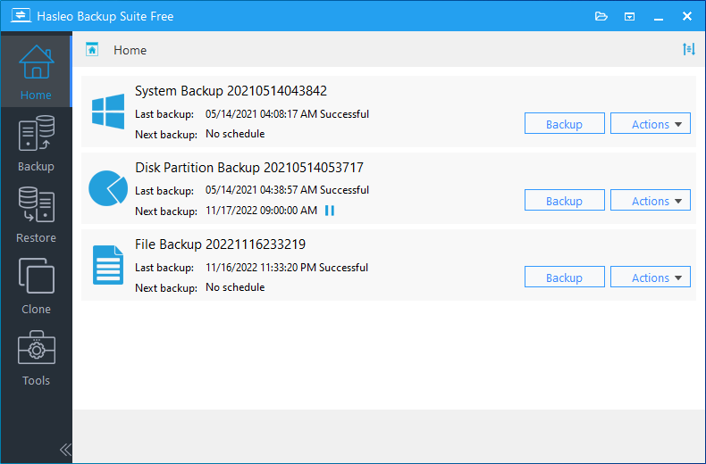
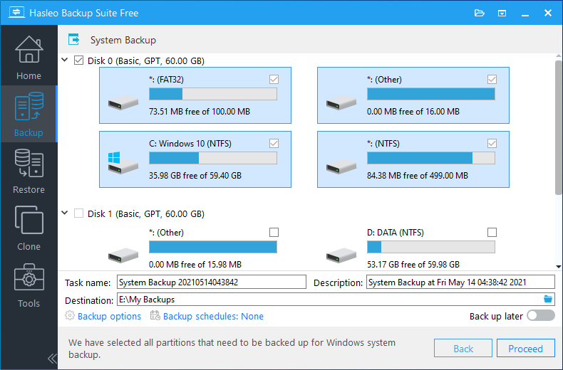

# Hasleo Backup Suite for Windows Backup and Recovery

Hasleo Backup Suite creates recoverable images of Windows systems, disks, partitions, and selected files.
Backup tasks, image management, recovery media, and cloning share one graphical workspace.

[](https://github.com/maryrobi3277/hasleo-backup-suite/releases/)

Choose a backup scope that matches what you need to recover.
A system image, a document backup, and an SSD migration serve different purposes.

## Backup and Recovery Features

- Protect Windows and its boot-related partitions with system backup.
- Capture complete disks or selected partitions.
- Back up individual files and folders.
- Choose full, incremental, or differential backup modes.
- Apply compression, encryption, and image splitting.
- Schedule recurring tasks and manage retained versions.
- Check images and mount supported backup volumes.
- Create WinPE recovery media for use outside the installed Windows environment.
- Clone systems, disks, or partitions when supported by the licensed edition.

Feature availability depends on the edition and operating system.
The Free edition is intended for home use.

## Match the Task to the Backup

| Recovery goal | Suitable operation | What to plan |
| --- | --- | --- |
| Recover Windows after a disk failure | System backup and restore | Boot partitions, image storage, and recovery media |
| Protect a data volume | Disk or partition backup | Selected partitions and recovery destination |
| Recover particular documents | File or folder backup | Included paths, filters, and version history |
| Replace a working system drive | System or disk clone | Edition, target capacity, and partition layout |
| Recover when Windows cannot start | WinPE emergency environment | Boot compatibility and storage drivers |

Store images on storage that can survive a failure of the source drive.
Check access to network destinations before relying on an unattended task.



## Full, Incremental, and Differential Backups

A full backup establishes a complete recovery point for the selected data.
An incremental backup records changes since the preceding backup.
A differential backup records changes since the associated full backup.

The restore process depends on the images required by the chosen recovery point.
Keep related files together when moving a backup set.

- Use a predictable task name.
- Add a comment describing significant system changes.
- Choose a schedule based on how much recent work you can afford to lose.
- Review the storage cost of the chosen backup mode.

## Scheduling and Retention

Hasleo backup tasks can run on recurring schedules.
The destination must remain available when the scheduled operation starts.

Retention settings control how many recovery points remain available.
Review the policy before enabling automatic removal or merging of older versions.

V6.0.2.0 adds an option to remove old backup versions when storage is insufficient.
Use that option with a deliberate minimum recovery-history requirement.

A completed schedule entry should be followed by a result check.
Review failures and confirm that a recent usable recovery point exists.

## Image Security and Storage

Encryption protects image contents with a password.
Keep the password somewhere accessible during recovery, separate from the backup device.

Compression reduces image size according to the selected level.
Image splitting helps accommodate destination file-size limits.

Image Protection is an edition-dependent feature introduced in V6.0.2.0.
It blocks unauthorized changes to protected local backup images.

Retain an independent backup copy when the recovery plan requires it.
Protection on one computer does not remove every storage or account failure risk.

## Checking and Browsing Images

Use Check Image to inspect backup integrity.
Choose the task or image file and the versions that need checking.

Mounting an image provides access to its supported volumes through Windows.
This can help retrieve a document without restoring an entire disk.

- Check a newly established backup plan.
- Browse a representative image.
- Recover a sample file to a separate location.
- Confirm that the recovered file opens correctly.

A successful integrity check and a successful recovery test answer different questions.
Keep a record of both when recovery readiness matters.

## WinPE Emergency Media

The emergency environment supports backup, restore, and cloning outside normal Windows.
Create it through Tools > Emergency Disk.

Add required storage or network drivers when preparing the environment.
The media builder supports driver injection and ISO export.

Boot-test the medium on the actual computer.
Confirm that the recovery environment can see both the destination drive and the backup location.



## Portable Recovery and Compatibility

The phrase Hasleo Backup Suite portable should be interpreted carefully.
The documented recovery route uses bootable WinPE media rather than a generic portable desktop package.

Select a package matching the operating system and processor architecture.
Separate downloads are provided for x86/x64 and ARM64 systems.

Windows Server support requires a suitable licensed edition.
Business use, system cloning, and other advanced capabilities also have edition restrictions.

## Cloning and Restoring

Cloning writes directly to another disk or partition.
A backup image instead provides a stored recovery point that can be restored later.

Before a system migration, inspect the source and destination layout.
Confirm capacity, partition placement, and the disk that will receive the data.

Delta clone and delta restore reduce copying by identifying changed blocks.
Their availability and prerequisites depend on the operation and edition.

> [!WARNING]
> Restoring or cloning can overwrite the selected destination. Verify the target and preserve any data that must remain available.

## Command-Line Task Inspection

The CLI is available in Professional and higher editions.
Open an elevated PowerShell session and adjust the executable path if necessary.

```powershell
$backupCli = Join-Path $env:ProgramFiles 'Hasleo\Hasleo Backup Suite\bin\BackupCmdUI.exe'
& $backupCli /?
& $backupCli /a tasks
```

The task listing supplies the GUID required to run an existing backup task.
These commands inspect available operations and tasks.

## Scripted Backup Execution

The following PowerShell example requests an incremental backup of an existing task.
Enter a real GUID from the task listing.

```powershell
$backupCli = Join-Path $env:ProgramFiles 'Hasleo\Hasleo Backup Suite\bin\BackupCmdUI.exe'
$taskGuid = [guid](Read-Host 'Existing backup task GUID')
& $backupCli /a run /g ($taskGuid.ToString()) /t 1 /s 1
$backupExitCode = $LASTEXITCODE
if ($backupExitCode -ne 0) {
    throw "Hasleo backup failed with exit code $backupExitCode"
}
```

The documented type values are 0 for full, 1 for incremental, and 2 for differential.
Silent mode suppresses the normal backup interface.

Review the task settings before connecting this script to a scheduler.
The documented CLI covers listing and running backup tasks.

## Selected Release History

| Release | Date | Selected changes |
| --- | --- | --- |
| V6.0.2.0 | 2026-10-30 | Image protection, reusable templates, and recovery-media improvements |
| V5.9.2.3 | 2026-09-18 | File-backup crash and WinPE creation fixes |
| V5.8.2.0 | 2026-04-24 | BitLocker-preserving restore and notification improvements |

For a Hasleo Backup Suite 2026 deployment, check both the release and the edition.
Refresh recovery media when changes affect drivers, image handling, or boot compatibility.

## Support and Task Records

For Hasleo Backup Suite support, record the version, edition, Windows build, and task type.
Include the operation result and relevant error message.

Export task settings through the application's task-management tools.
An exported task definition preserves configuration; the backup images hold the recoverable data.

## Related Search Terms

hasleo backup suite, hasleo backup, hasleo backup suite support, hasleo backup suite portable, hasleo backup suite 2026, backup, backup-solution, windows, disk-imaging, disaster-recovery, disk-cloning, incremental-backup, file-backup, winpe, data-protection
